# Regresión lineal múltiple para predecir el precio del dólar, la glucosa en sangre y el consumo de energía

Informe del laboratorio de minería de datos

## Resumen

Este informe presenta un laboratorio de minería de datos desarrollado con la metodología CRISP-DM. Se ajustaron tres modelos de regresión lineal múltiple para predecir variables cuantitativas en contextos distintos: el precio del dólar a partir del día, la inflación y la tasa de interés; el nivel de glucosa en sangre a partir de la edad, el índice de masa corporal y la actividad física; y el consumo de energía eléctrica a partir de la temperatura, la hora y el día de la semana. Cada modelo se entrenó con el 80 % de los datos y se evaluó con el 20 % restante. En los datos de prueba, el modelo del dólar obtuvo un R² de 0,9963 (MSE = 2.376,97), el de glucosa un R² de 0,6814 (MSE = 233,69) y el de energía un R² de 0,8968 (RMSE = 20,72 kWh). Las variables de mayor impacto fueron el día, la edad y la temperatura, respectivamente. Los modelos se exportaron con joblib y se integraron en una interfaz web desarrollada con Streamlit, donde el usuario elige el ejercicio, escribe los valores de las variables y obtiene la predicción.

*Palabras clave:* minería de datos, CRISP-DM, regresión lineal múltiple, scikit-learn, Streamlit

## Introducción

La regresión lineal múltiple es uno de los modelos más usados para predecir una variable cuantitativa a partir de varias variables explicativas. Su principal ventaja es la interpretabilidad: cada coeficiente indica cuánto cambia la predicción cuando una variable aumenta en una unidad y las demás se mantienen constantes (James et al., 2021).

El objetivo del laboratorio es aplicar las fases de la metodología CRISP-DM (Chapman et al., 2000) para integrar un modelo de regresión lineal en tres contextos, interpretar sus resultados, evaluar su desempeño, exportarlo y construir una interfaz web básica que permita hacer predicciones. Los tres ejercicios son:

1. Predicción del precio del dólar (`dolar_data.csv`).
2. Predicción del nivel de glucosa en sangre (`glucosa_data.csv`).
3. Predicción del consumo de energía eléctrica (`energia_data.csv`).

## Metodología

El trabajo siguió las seis fases de CRISP-DM. Las cinco primeras se aplicaron a cada ejercicio en un notebook de Jupyter independiente, y la fase de despliegue corresponde a la exportación de los modelos y a la interfaz web.

### Comprensión del negocio y de los datos

En cada ejercicio se definió la variable a predecir y las preguntas a responder. Luego se revisaron los tipos de dato, los valores nulos, los registros duplicados, las estadísticas descriptivas y la correlación de Pearson entre las variables. La Tabla 1 resume los tres conjuntos de datos.

*Tabla 1. Conjuntos de datos del laboratorio*

| Ejercicio | Archivo | Filas | Variables independientes | Variable dependiente |
|---|---|---|---|---|
| Dólar | dolar_data.csv | 500 | Dia, Inflacion, Tasa_interes | Precio_Dolar (COP) |
| Glucosa | glucosa_data.csv | 2.000 | Edad, IMC, Actividad_Fisica | Nivel_Glucosa (mg/dL) |
| Energía | energia_data.csv | 10.000 | Temperatura, Hora, Dia_Semana | Consumo_Energia (kWh) |

*Nota.* Ninguno de los tres conjuntos tiene valores nulos ni filas duplicadas.

### Preparación de los datos

Los valores atípicos se identificaron con la regla del rango intercuartílico (IQR): un valor es atípico si está por debajo de Q1 − 1,5·IQR o por encima de Q3 + 1,5·IQR. Antes de eliminar un registro se verificó si el valor era físicamente imposible (un error de captura) o un caso extremo pero real. En los tres conjuntos los valores marcados resultaron posibles, por lo que se conservaron todas las filas. Luego, los datos se dividieron en un 80 % para entrenamiento y un 20 % para prueba, con una semilla fija (`random_state = 42`) para que los resultados sean reproducibles.

### Modelado

Se ajustó un modelo de regresión lineal múltiple por mínimos cuadrados ordinarios con la clase `LinearRegression` de scikit-learn (Pedregosa et al., 2011), de la forma ŷ = β₀ + β₁x₁ + β₂x₂ + β₃x₃. El mismo modelo se ajustó con statsmodels (Seabold & Perktold, 2010) para obtener los p-valores de cada coeficiente y el factor de inflación de la varianza (VIF), que mide la multicolinealidad entre las variables.

### Evaluación

El desempeño se midió en los datos de prueba con el error cuadrático medio (MSE), su raíz (RMSE), el error absoluto medio (MAE) y el coeficiente de determinación (R²). Para descartar sobreajuste se compararon las métricas de entrenamiento y de prueba, y se calculó el R² con validación cruzada de cinco pliegues. La importancia de cada variable se midió con el **coeficiente estandarizado** (β), que expresa el efecto en desviaciones estándar y por eso permite comparar variables con unidades distintas.

## Ejercicio 1: predicción del precio del dólar

### Comprensión y preparación de los datos

El conjunto tiene 500 días consecutivos. La Tabla 2 muestra sus estadísticas descriptivas. La regla IQR marca 4 valores de inflación y 7 de tasa de interés, pero todos están en rangos económicamente posibles (inflación entre 0,38 % y 3,93 %), así que se conservaron las 500 filas. La correlación del precio con el día es de r = 0,998, mientras que con la inflación es de 0,020 y con la tasa de interés de 0,074.

*Tabla 2. Estadísticas descriptivas del conjunto del dólar*

| Variable | Media | Desv. estándar | Mínimo | Máximo | Atípicos (IQR) |
|---|---|---|---|---|---|
| `Dia` | 250 | 144 | 1 | 500 | 0 |
| `Inflacion` | 0,0200 | 0,0049 | 0,0038 | 0,0393 | 4 |
| `Tasa_interes` | 5,02 | 0,49 | 3,65 | 6,32 | 7 |
| `Precio_Dolar` | 5.211,77 | 723,90 | 3.940,36 | 6.553,60 | 0 |

### Modelo e interpretación de los coeficientes

La ecuación ajustada es:

`Precio_Dolar = 3.985,7833 + 4,9843 × Dia − 870,7317 × Inflacion − 1,3774 × Tasa_interes`

*Tabla 3. Coeficientes del modelo del dólar*

| Término | Coeficiente | β estandarizado | Importancia | p-valor |
|---|---|---|---|---|
| Intercepto (β₀) | 3.985,7833 | — | — | — |
| `Dia` | 4,9843 | 0,998 | 99,3 % | < 0,001 |
| `Inflacion` | -870,7317 | -0,006 | 0,6 % | 0,096 |
| `Tasa_interes` | -1,3774 | -0,001 | 0,1 % | 0,797 |

*Nota.* El β estandarizado es el coeficiente multiplicado por la desviación estándar de la variable y dividido por la del precio. La importancia es el porcentaje de |β| sobre la suma de los tres.

- **Día:** cada día adicional, el precio sube 4,98 COP, manteniendo constantes las demás variables. Es significativo (p < 0,001) y concentra el 99,3 % del impacto.
- **Inflación:** por cada punto porcentual adicional (0,01), el precio baja 8,71 COP. El efecto **no es estadísticamente significativo** (p = 0,096).
- **Tasa de interés:** por cada punto adicional, el precio baja 1,38 COP. Tampoco es significativa (p = 0,797).

Los VIF de las tres variables son cercanos a 1, así que no hay multicolinealidad y los coeficientes se pueden interpretar por separado.

### Desempeño del modelo

*Tabla 4. Métricas del modelo del dólar*

| Métrica | Entrenamiento | Prueba |
|---|---|---|
| MSE (COP)² | 2.580,46 | 2.376,97 |
| RMSE (COP) | 50,80 | 48,75 |
| MAE (COP) | 40,47 | 37,01 |
| R² | 0,9948 | 0,9963 |

El modelo explica el 99,6 % de la variación del precio en los datos de prueba. El RMSE de 48,75 COP equivale al 0,9 % del precio promedio (5.211,77 COP). El R² con validación cruzada fue de 0,9949 ± 0,0011, muy parecido al de prueba, por lo que no hay sobreajuste.

### Visualizaciones

La Figura 1 muestra la relación de cada variable independiente con el precio. El día forma una línea casi perfecta, mientras que la inflación y la tasa de interés aparecen como nubes horizontales sin tendencia. La Figura 2 compara los valores reales con los predichos.

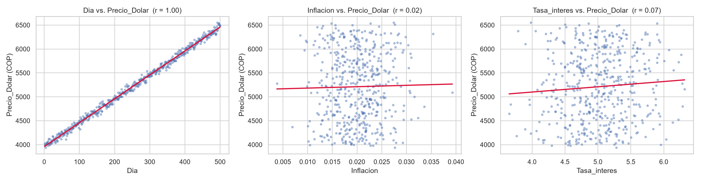

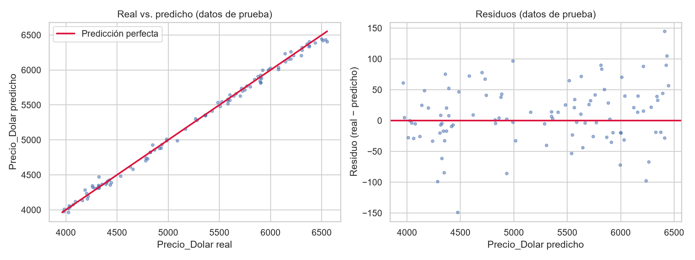

## Ejercicio 2: predicción del nivel de glucosa en sangre

### Comprensión y preparación de los datos

El conjunto tiene 2.000 pacientes (Tabla 5). La regla IQR marca 16 valores de IMC y 3 de glucosa. Son valores extremos pero clínicamente posibles (delgadez severa, obesidad, hipoglucemia o hiperglucemia), y eliminarlos haría que el modelo ignorara justo a los pacientes de mayor riesgo. Por eso se conservaron todas las filas.

*Tabla 5. Estadísticas descriptivas del conjunto de glucosa*

| Variable | Media | Desv. estándar | Mínimo | Máximo | Atípicos (IQR) |
|---|---|---|---|---|---|
| `Edad` | 49,2 | 17,5 | 20,0 | 79,0 | 0 |
| `IMC` | 24,96 | 3,98 | 10,59 | 39,43 | 16 |
| `Actividad_Fisica` | 4,7 | 2,9 | 0,0 | 9,0 | 0 |
| `Nivel_Glucosa` | 139,63 | 27,34 | 43,42 | 227,56 | 3 |

### Modelo e interpretación de los coeficientes

La ecuación ajustada es:

`Nivel_Glucosa = 65,8609 + 1,2266 × Edad + 0,9334 × IMC − 2,0853 × Actividad_Fisica`

*Tabla 6. Coeficientes del modelo de glucosa*

| Término | Coeficiente | β estandarizado | Importancia | p-valor |
|---|---|---|---|---|
| Intercepto (β₀) | 65,8609 | — | — | — |
| `Edad` | 1,2266 | 0,787 | 68,7 % | < 0,001 |
| `Actividad_Fisica` | -2,0853 | -0,223 | 19,4 % | < 0,001 |
| `IMC` | 0,9334 | 0,136 | 11,9 % | < 0,001 |

Las tres variables son estadísticamente significativas (p < 0,05):

- **Edad:** cada año adicional sube la glucosa 1,23 mg/dL.
- **IMC:** cada punto adicional sube la glucosa 0,93 mg/dL.
- **Actividad física:** cada hora semanal de ejercicio baja la glucosa 2,09 mg/dL.

### Variable de mayor impacto

La **edad** es la variable de mayor impacto: tiene el coeficiente estandarizado más alto (β = 0,787), concentra el 68,7 % de la importancia y es la más correlacionada con la glucosa (r = 0,79). Para comparar en términos prácticos: pasar del percentil 25 al percentil 75 de cada variable cambia la glucosa en 36,8 mg/dL en el caso de la edad, en -10,4 mg/dL en el de la actividad física y en 5,0 mg/dL en el del IMC (Figura 4). Aunque el coeficiente del IMC por unidad es parecido al de la edad, el IMC varía mucho menos entre pacientes, y por eso su impacto total es menor.

### Desempeño del modelo

*Tabla 7. Métricas del modelo de glucosa*

| Métrica | Entrenamiento | Prueba |
|---|---|---|
| MSE (mg/dL)² | 235,51 | 233,69 |
| RMSE (mg/dL) | 15,35 | 15,29 |
| MAE (mg/dL) | 12,11 | 12,22 |
| R² | 0,6862 | 0,6814 |

El modelo explica el 68,1 % de la variación de la glucosa, con un error típico (RMSE) de 15,29 mg/dL, equivalente al 10,9 % del promedio. El R² con validación cruzada fue de 0,6833 ± 0,0070, sin señales de sobreajuste. El 32 % restante de la variación depende de factores que no están en los datos, como la dieta, la genética o la medicación.

### Visualizaciones

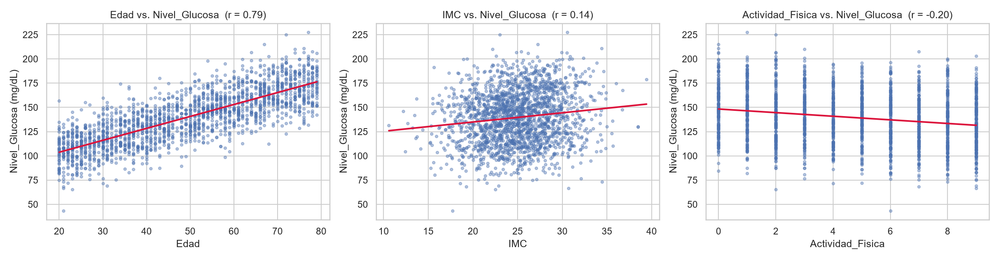

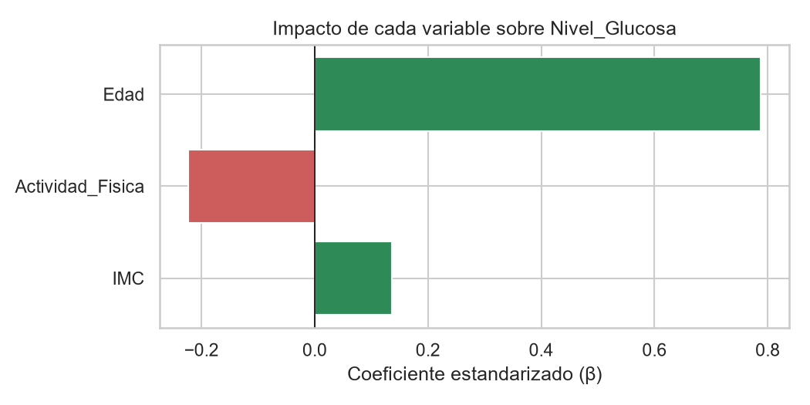

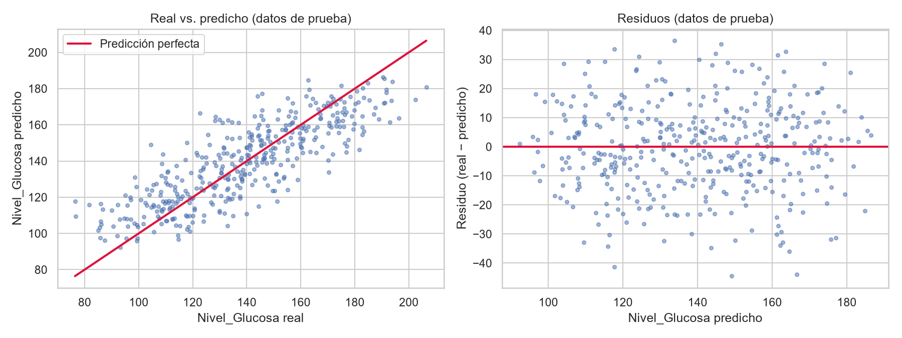

## Ejercicio 3: predicción del consumo de energía eléctrica

### Comprensión y preparación de los datos

El conjunto tiene 10.000 registros (Tabla 8). La regla IQR marca 90 temperaturas y 66 consumos. Corresponden a días muy fríos o muy calurosos con consumos coherentes con esa temperatura, así que se conservaron todas las filas.

*Tabla 8. Estadísticas descriptivas del conjunto de energía*

| Variable | Media | Desv. estándar | Mínimo | Máximo | Atípicos (IQR) |
|---|---|---|---|---|---|
| `Temperatura` | 24,92 | 5,00 | 5,39 | 44,63 | 90 |
| `Hora` | 12,5 | 6,9 | 1,0 | 24,0 | 0 |
| `Dia_Semana` | 4,0 | 2,0 | 1,0 | 7,0 | 0 |
| `Consumo_Energia` | 400,04 | 63,83 | 185,20 | 631,09 | 66 |

### Tratamiento de la hora

El enunciado indica que la hora es una variable "ciclada" (después de la 24 vuelve la 1). Una práctica común con este tipo de variables es codificarlas con seno y coseno, para que el modelo entienda que la hora 24 y la hora 1 están cerca. Antes de decidir, se analizó el consumo promedio por hora (Figura 6): sube casi en línea recta, de 348,0 kWh en la hora 1 a 459,1 kWh en la hora 24, sin volver a bajar. Por eso la codificación cíclica no se ajusta a estos datos, lo que se confirmó con validación cruzada (Tabla 9).

*Tabla 9. Comparación de dos formas de usar la hora*

| Codificación de la hora | R² medio (validación cruzada, 5 pliegues) |
|---|---|
| Hora lineal (1 a 24) | 0,9004 |
| Hora cíclica (seno y coseno) | 0,7854 |

Se usó la hora tal como viene (1 a 24). El día de la semana también muestra una tendencia casi lineal (el consumo promedio baja de 412,2 kWh el lunes a 391,0 kWh el domingo), así que se dejó como variable numérica.

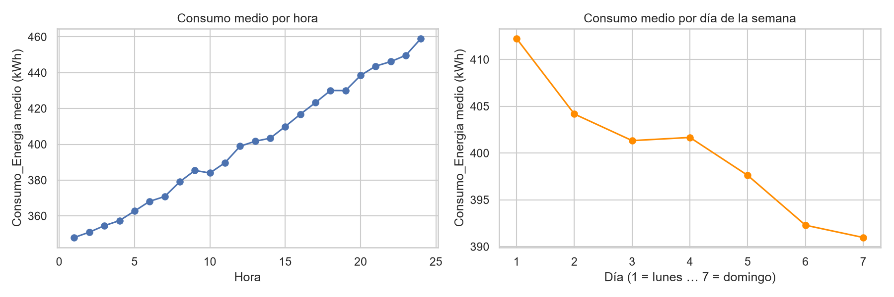

### Modelo e interpretación de los coeficientes

La ecuación ajustada es:

`Consumo_Energia = 101,2882 + 9,9529 × Temperatura + 5,0198 × Hora − 3,0312 × Dia_Semana`

*Tabla 10. Coeficientes del modelo de energía*

| Término | Coeficiente | β estandarizado | Importancia | p-valor |
|---|---|---|---|---|
| Intercepto (β₀) | 101,2882 | — | — | — |
| `Temperatura` | 9,9529 | 0,780 | 54,9 % | < 0,001 |
| `Hora` | 5,0198 | 0,546 | 38,4 % | < 0,001 |
| `Dia_Semana` | -3,0312 | -0,095 | 6,7 % | < 0,001 |

Las tres variables son estadísticamente significativas (p < 0,05):

- **Temperatura:** cada grado Celsius adicional sube el consumo 9,95 kWh.
- **Hora:** cada hora más tarde en el día sube el consumo 5,02 kWh.
- **Día de la semana:** cada día más adelante en la semana baja el consumo 3,03 kWh, así que el domingo se consumen unos 18,2 kWh menos que el lunes.

### Variable de mayor impacto

La **temperatura** es la variable de mayor impacto (β = 0,780, 54,9 % de la importancia), seguida de la hora (β = 0,546). El día de la semana tiene un efecto pequeño (β = -0,095). Las Figuras 7 y 8 muestran las relaciones más importantes mediante gráficas de dispersión y de correlación, y la Figura 9 compara el impacto de las variables.

### Desempeño del modelo

*Tabla 11. Métricas del modelo de energía*

| Métrica | Entrenamiento | Prueba |
|---|---|---|
| MSE (kWh)² | 399,19 | 429,52 |
| RMSE (kWh) | 19,98 | 20,72 |
| MAE (kWh) | 15,92 | 16,51 |
| R² | 0,9015 | 0,8968 |

El modelo explica el 89,7 % de la variación del consumo, con un **RMSE de 20,72 kWh**, equivalente al 5,2 % del consumo promedio (400,04 kWh). El R² con validación cruzada fue de 0,9004 ± 0,0035, sin señales de sobreajuste.

### Visualizaciones

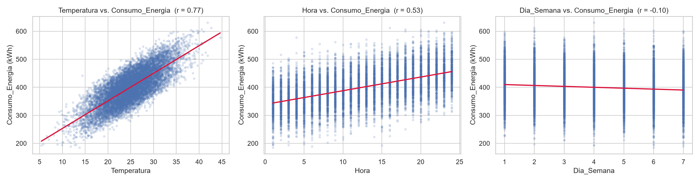

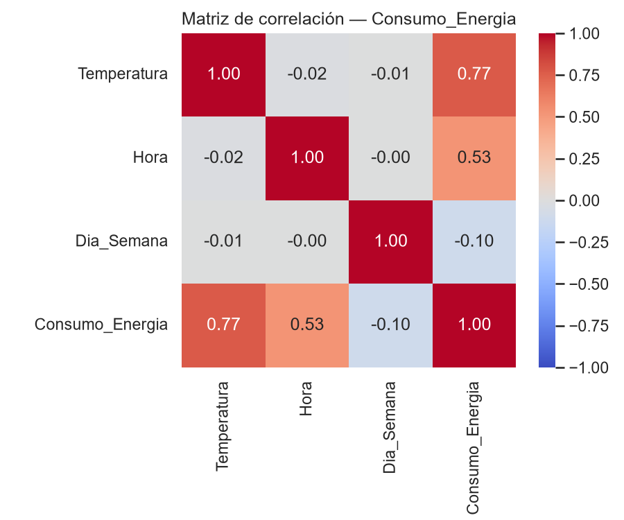

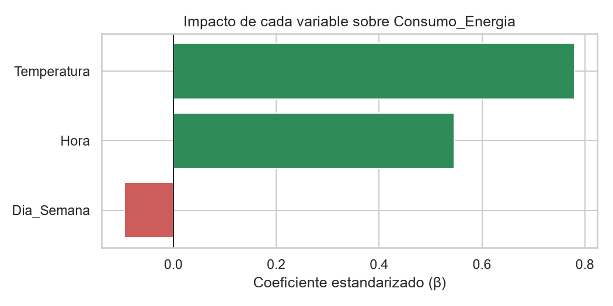

## Exportación de los modelos

Un modelo entrenado se puede guardar en un archivo para usarlo después sin volver a entrenarlo. En Python hay dos opciones habituales (Tabla 12).

*Tabla 12. Comparación de pickle y joblib*

| Aspecto | pickle | joblib |
|---|---|---|
| Qué es | Módulo estándar de Python | Librería usada por scikit-learn |
| Guardar | `pickle.dump(modelo, archivo)` | `joblib.dump(modelo, ruta)` |
| Cargar | `pickle.load(archivo)` | `joblib.load(ruta)` |
| Ventaja | No requiere instalar nada | Más eficiente con arreglos de NumPy |

Se eligió **joblib**, siguiendo la recomendación de la documentación de scikit-learn (scikit-learn developers, 2026). Cada archivo (`modelo_dolar.joblib`, `modelo_glucosa.joblib` y `modelo_energia.joblib`) guarda el modelo entrenado junto con los nombres de las variables, las métricas, los coeficientes, los p-valores y el rango de los datos de entrenamiento, que la interfaz web usa para mostrar la información del modelo y advertir cuando un valor está fuera de ese rango. Al cargar cada archivo se comprobó que el modelo recuperado produce exactamente las mismas predicciones que el original. Como un modelo guardado solo es compatible con la versión de scikit-learn con la que se creó, esa versión (1.9.1) queda registrada en el archivo y fijada en `requirements.txt`.

## Interfaz web

La interfaz se desarrolló con Streamlit (Snowflake Inc., 2026), una de las tecnologías sugeridas en el enunciado. Al iniciar, carga los tres modelos exportados. El usuario:

1. Elige el ejercicio (Dólar, Glucosa o Energía) en el panel lateral.
2. Escribe con el teclado los valores de las variables independientes.
3. Pulsa **Calcular predicción** y ve el valor estimado, su margen de error típico (± RMSE) y el cálculo paso a paso con la ecuación del modelo.

Además, la interfaz tiene pestañas con el desempeño del modelo (R², MSE, RMSE y MAE), la interpretación de los coeficientes, las gráficas y los datos. La Figura 10 muestra una predicción para un paciente de 60 años con IMC de 31,5 y 2 horas semanales de ejercicio, y la Figura 11 la interpretación de los coeficientes. La interfaz se verificó con pruebas automáticas que comprueban que la predicción de cada ejercicio coincide con la ecuación del modelo.

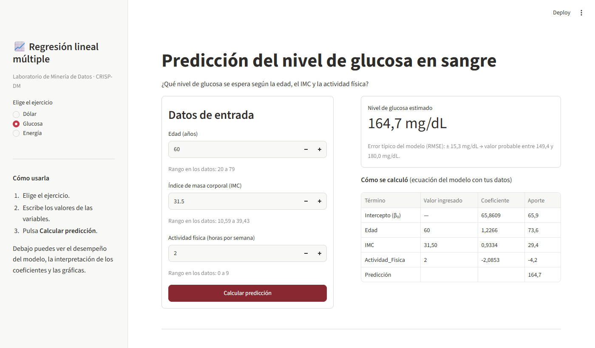

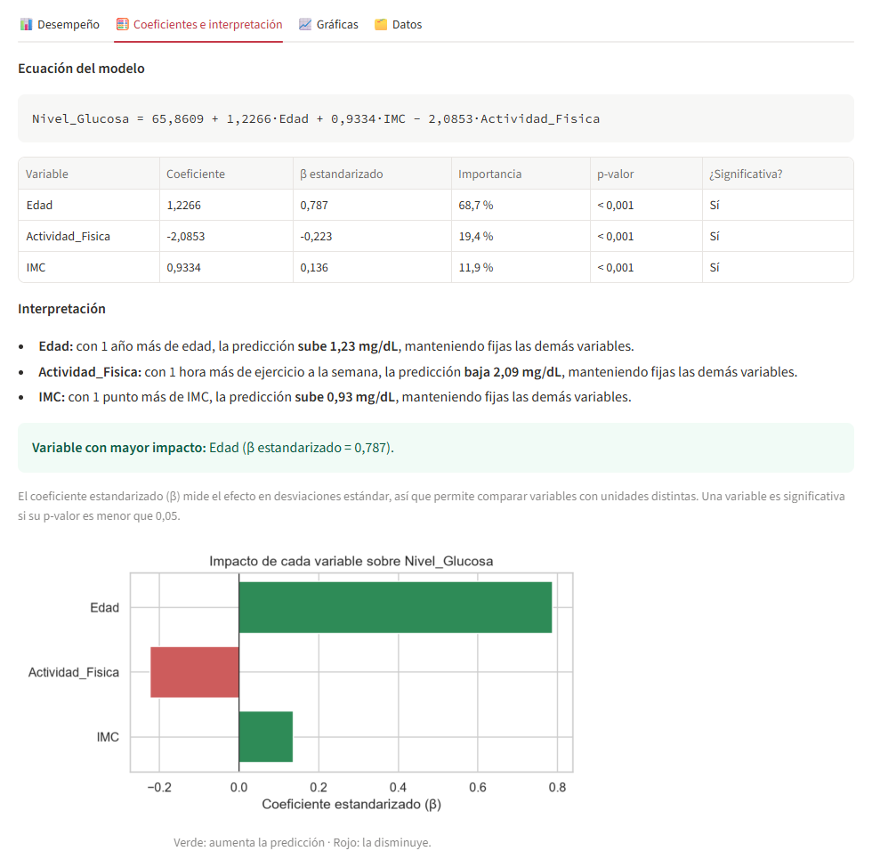

## Conclusiones

*Tabla 13. Resumen de los tres modelos (datos de prueba)*

| Ejercicio | R² | MSE | RMSE | Variable de mayor impacto |
|---|---|---|---|---|
| Dólar | 0,9963 | 2.376,97 | 48,75 COP | Día |
| Glucosa | 0,6814 | 233,69 | 15,29 mg/dL | Edad |
| Energía | 0,8968 | 429,52 | 20,72 kWh | Temperatura |

1. Los tres modelos de regresión lineal múltiple generalizan bien: las métricas de entrenamiento, de prueba y de validación cruzada son casi iguales, así que no hay sobreajuste.
2. El modelo del dólar tiene el mejor ajuste (R² = 0,9963), pero se debe casi por completo a la tendencia del día. La inflación y la tasa de interés no son significativas en estos datos, por lo que el modelo funciona en la práctica como una tendencia en el tiempo y no se debe usar para extrapolar a fechas lejanas.
3. En la glucosa, la edad es la variable de mayor impacto, seguida de la actividad física y del IMC. El modelo explica el 68 % de la variación: es útil para estimar tendencias, pero una parte importante depende de factores que no están en los datos.
4. En el consumo de energía, la temperatura es la variable de mayor impacto, seguida de la hora. Analizar los datos antes de modelar fue decisivo: la codificación cíclica de la hora, que suele recomendarse para este tipo de variables, habría bajado el R² de 0,90 a 0,79.
5. Los coeficientes estandarizados permitieron comparar el impacto de variables con unidades distintas, y los p-valores permitieron distinguir los efectos reales de los que podrían deberse al azar.
6. Exportar los modelos con joblib e integrarlos en una interfaz web completa el ciclo de CRISP-DM: los modelos dejan de estar solo en un notebook y cualquier usuario puede usarlos para hacer predicciones.

## Referencias

- Chapman, P., Clinton, J., Kerber, R., Khabaza, T., Reinartz, T., Shearer, C., & Wirth, R. (2000). *CRISP-DM 1.0: Step-by-step data mining guide*. SPSS Inc.
- James, G., Witten, D., Hastie, T., & Tibshirani, R. (2021). *An introduction to statistical learning: With applications in R* (2.ª ed.). Springer. https://doi.org/10.1007/978-1-0716-1418-1
- Pedregosa, F., Varoquaux, G., Gramfort, A., Michel, V., Thirion, B., Grisel, O., Blondel, M., Prettenhofer, P., Weiss, R., Dubourg, V., Vanderplas, J., Passos, A., Cournapeau, D., Brucher, M., Perrot, M., & Duchesnay, É. (2011). Scikit-learn: Machine learning in Python. *Journal of Machine Learning Research, 12*, 2825–2830.
- scikit-learn developers. (2026). *Model persistence*. https://scikit-learn.org/stable/model_persistence.html
- Seabold, S., & Perktold, J. (2010). Statsmodels: Econometric and statistical modeling with Python. En *Proceedings of the 9th Python in Science Conference* (pp. 92–96). https://doi.org/10.25080/Majora-92bf1922-011
- Snowflake Inc. (2026). *Streamlit documentation*. https://docs.streamlit.io
